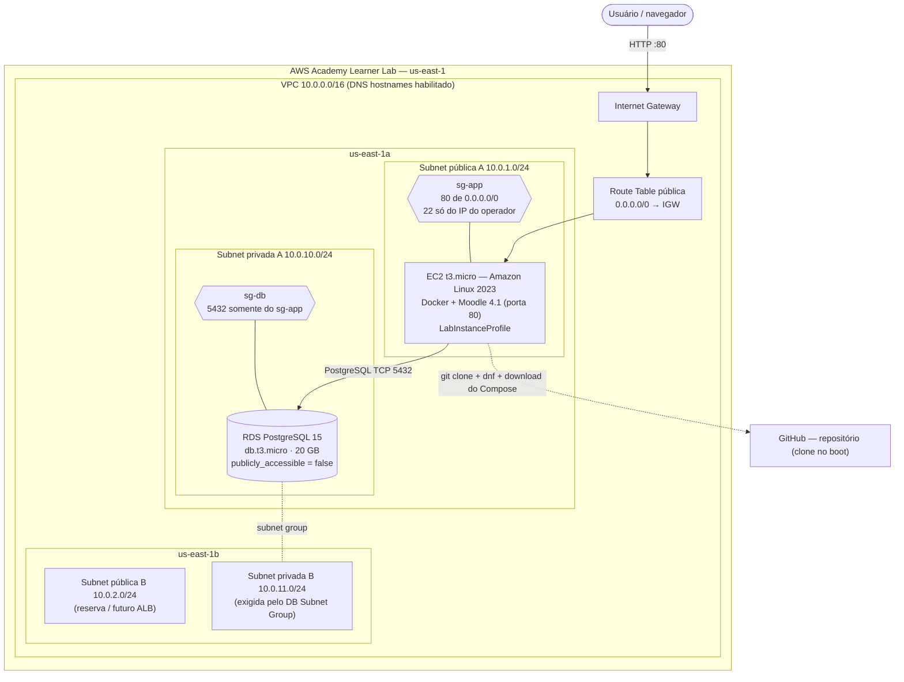

# Design de Arquitetura — Moodle na AWS (Learner Lab)

> Documento da solução entregue no desafio **Moodle Docker AWS Challenge** (DevOps 2026.2, UniFAAT).
> Autor: Gabriel Reis Cunha (RA 6325149). Todo o código descrito aqui está em `terraform/` e `docker/` deste repositório.
> Uso de IA: o código dos módulos Terraform e do workflow foi gerado pelo **Kiro** (com revisão e correções do aluno e do Claude Code); este documento foi redigido pelo Claude Code a partir do código real e revisado pelo aluno. O detalhamento está no `entrega.md`.

## Visão Geral

A solução publica o **Moodle 4.1** (plataforma de e-learning) na AWS de forma **reprodutível**: toda a infraestrutura é descrita em Terraform e o Moodle sobe sozinho no primeiro boot da instância, sem passos manuais.

A arquitetura tem três camadas dentro de uma única VPC na região `us-east-1` (a única permitida no AWS Academy Learner Lab):

1. **Rede (`networking`)**: VPC `10.0.0.0/16` com 2 subnets públicas e 2 subnets privadas em duas Availability Zones, Internet Gateway, route table pública e dois security groups (`sg-app` e `sg-db`).
2. **Banco de dados (`database`)**: uma instância **RDS PostgreSQL 15** (`db.t3.micro`, 20 GB) em subnets privadas, sem acesso público, acessível apenas a partir do `sg-app`.
3. **Aplicação (`compute`)**: uma instância **EC2 `t3.micro`** (Amazon Linux 2023) em subnet pública. No primeiro boot, o script `user_data.sh` instala o Docker e o Docker Compose v2, clona este repositório, grava o arquivo `.env` com os dados do RDS e executa `docker compose up -d --build`. O contêiner do Moodle (Apache + PHP 8.1) se conecta ao RDS pela rede privada e, na primeira execução, instala o Moodle automaticamente por linha de comando (`entrypoint.sh`).

O módulo raiz (`terraform/main.tf`) liga as saídas de um módulo às entradas do outro (`networking → database → compute`), e o Terraform deduz a ordem de criação por essas referências: a EC2 só é criada depois que o RDS existe, porque precisa do endereço dele.

As decisões de alto nível foram guiadas por três restrições: (a) o **Learner Lab proíbe IAM, Route 53, ACM e CloudFront**, então o acesso é por HTTP no DNS público da EC2 e o perfil de instância `LabInstanceProfile` já existente é reaproveitado; (b) **custo e tempo**: recursos mínimos (`t3.micro`, `db.t3.micro`) e sem NAT Gateway; (c) **segurança por camadas**: o banco nunca é exposto à internet.

## Diagrama de Arquitetura



Versão em texto (ASCII), para leitura fora do GitHub:

```
Usuário ──HTTP:80──▶ [Internet Gateway] ──▶ [Route Table pública 0.0.0.0/0→IGW]
                                                         │
 ┌──────────────────────────── VPC 10.0.0.0/16 ──────────┼──────────────────────────┐
 │  us-east-1a                                           ▼                          │
 │  ┌─ Subnet pública A 10.0.1.0/24 ───────────────────────────────┐                │
 │  │  EC2 t3.micro (AL2023) · Docker + Moodle · porta 80          │  sg-app:       │
 │  │  LabInstanceProfile                                          │  80 ← internet │
 │  └──────────────────────────────┬───────────────────────────────┘  22 ← seu IP   │
 │                                 │ TCP 5432                                       │
 │  ┌─ Subnet privada A 10.0.10.0/24 ─▼────────────────────────────┐  sg-db:        │
 │  │  RDS PostgreSQL 15 · db.t3.micro · sem acesso público        │  5432 ← sg-app │
 │  └──────────────────────────────────────────────────────────────┘                │
 │  us-east-1b: subnet pública B 10.0.2.0/24 · subnet privada B 10.0.11.0/24        │
 └──────────────────────────────────────────────────────────────────────────────────┘
```

**Fluxo do usuário até o banco:** navegador → Internet Gateway → route table pública → EC2 (Apache/PHP no contêiner) → RDS pela porta 5432, dentro da VPC. O RDS nunca recebe tráfego da internet.

## Decisões de Design

| Componente | Escolha | Justificativa |
|---|---|---|
| Tipo da EC2 | `t3.micro` | Requisito do enunciado da prova. Tem 1 GB de RAM, por isso o `user_data` cria **2 GB de swap** antes do `docker build` (a compilação das extensões PHP pode estourar a memória). Burstable, adequado a carga de estudo. |
| Engine e classe do RDS | PostgreSQL 15 · `db.t3.micro` · 20 GB `gp2` | Mesma versão do ambiente Docker local (`postgres:15`), o que evita diferenças entre local e nuvem; classe mínima para custo baixo. |
| AMI | Amazon Linux 2023 por *data source* (`al2023-ami-2023.*-x86_64`) | Sem ID de AMI fixo (IDs mudam por região e data); o filtro `2023.*` evita a variante *minimal*. O AL2023 **não** possui o pacote `docker-compose-plugin`, então o Compose v2 é instalado como binário. |
| Topologia de rede | VPC `10.0.0.0/16` · 2 subnets públicas + 2 privadas em 2 AZs | Exigência da prova. O *DB Subnet Group* exige ≥ 2 AZs; as duas públicas deixam o desenho pronto para um ALB (que também exige 2 AZs). Os CIDRs derivam da VPC com `cidrsubnet()`. |
| Sem NAT Gateway | Subnets privadas sem rota para a internet | O RDS não precisa sair para a internet; o NAT teria custo fixo por hora. Reforça o isolamento do banco. |
| Acesso IAM da EC2 | `iam_instance_profile = "LabInstanceProfile"` (string literal) | O Learner Lab não permite criar roles/profiles; reaproveitamos o perfil pré-existente. Nenhum recurso `aws_iam_*` é declarado. |
| Como o código chega à EC2 | `git clone` do repositório + `docker compose build` na própria EC2 | Mais simples que ECR para o escopo da prova (sem registry, sem pipeline de build). Troca: o boot é mais lento (build de ~minutos). Em produção: imagem pré-construída no ECR. |
| Instalação do Moodle | `entrypoint.sh` executa `admin/cli/install.php` na primeira execução | O template abria o instalador web, que exigia passos manuais. A instalação por CLI torna o deploy 100% automático e idempotente (só instala se não houver `config.php`). |
| URL do Moodle (`wwwroot`) | Calculada no boot via **IMDSv2** (token + `public-hostname`, com fallback para `public-ipv4`) | O DNS público da EC2 só existe depois da criação; o Moodle precisa dele para gerar links. O AL2023 exige IMDSv2 (token), por isso o `curl` simples falharia com 401. |
| Segredos | Variáveis `sensitive` + `terraform.tfvars` fora do Git | Senhas nunca aparecem no código nem no plan (`(sensitive value)`). Limites descritos na seção Segurança. |
| Acesso HTTP | Apenas HTTP na porta 80 | ACM e CloudFront são bloqueados no Learner Lab; sem certificado não há HTTPS. |
| Estado do Terraform | Local (`terraform.tfstate`, ignorado pelo Git) | Escopo individual e efêmero (apply curto + destroy). Em equipe: backend S3 com bloqueio de estado. |
| RDS descartável | `skip_final_snapshot = true`, `deletion_protection = false`, `backup_retention_period = 0` | Permite `terraform destroy` rápido no Lab. Em produção seria o oposto. |

> **Observação:** o `docs/architecture.md` e a rubrica do template citam `t3.medium` e uma única subnet pública. Seguimos o **enunciado da prova** (`t3.micro`, ≥ 2 subnets públicas), que é o documento mais recente.

## Componentes

### VPC
Recurso `aws_vpc.this` com bloco `10.0.0.0/16`, `enable_dns_support = true` e `enable_dns_hostnames = true`. O segundo atributo é essencial: sem ele a EC2 não recebe DNS público e o Moodle montaria uma URL inválida.

### Subnets
| Nome | Tipo | CIDR | AZ | Hospeda |
|---|---|---|---|---|
| `moodle-public-a` | pública | `10.0.1.0/24` | us-east-1a | EC2 do Moodle |
| `moodle-public-b` | pública | `10.0.2.0/24` | us-east-1b | (reserva; futuro ALB) |
| `moodle-private-a` | privada | `10.0.10.0/24` | us-east-1a | RDS |
| `moodle-private-b` | privada | `10.0.11.0/24` | us-east-1b | Exigida pelo DB Subnet Group |

As públicas têm `map_public_ip_on_launch = true`; as privadas não. As privadas ficam associadas à route table principal da VPC, que só tem a rota local — **sem caminho para a internet**.

### Internet Gateway e Route Table
`aws_internet_gateway.this` anexado à VPC. A `aws_route_table.public` tem a rota `0.0.0.0/0 → IGW` e é associada às duas subnets públicas; é essa rota que torna uma subnet "pública".

### Security Group — EC2 (`sg-app`)
- **Entrada:** TCP 80 de `0.0.0.0/0` (acesso ao Moodle); TCP 22 **somente** do CIDR `ssh_allowed_cidr` (o IP do operador, `/32`; a variável não tem valor padrão e rejeita `0.0.0.0/0` e valores que não sejam CIDR).
- **Saída:** liberada, pois a instância precisa baixar pacotes (dnf), o binário do Compose, clonar o repositório e baixar a imagem base do Docker.

### Security Group — RDS (`sg-db`)
- **Entrada:** TCP 5432 com **origem = `sg-app`** (referência ao grupo, não a um CIDR). Só quem está associado ao `sg-app` alcança o banco, mesmo que o IP da EC2 mude.
- **Saída:** liberada (simplicidade; ver melhorias de produção).

### Instância EC2
- `aws_instance.moodle`: `t3.micro`, AMI AL2023 (data source), subnet `moodle-public-a`, `sg-app`, `LabInstanceProfile`, `user_data_replace_on_change = true` (se o script mudar, a instância é recriada, pois o `user_data` só roda no primeiro boot).
- **Sequência do `user_data.sh`** (com `set -euo pipefail` e log em `/var/log/user-data.log`): (1) instala `docker` e `git`; (2) baixa o Docker Compose v2 (`v2.29.7`) para `/usr/local/lib/docker/cli-plugins/`; (3) habilita e inicia o Docker; (4) cria 2 GB de swap; (5) clona o repositório; (6) obtém o hostname público via IMDSv2; (7) grava `docker/.env` com permissão `600`; (8) espera o RDS responder na porta 5432 (até 120 s); (9) executa `docker compose -f docker/docker-compose.aws.yml up -d --build`.
- Não há *key pair* associado (acesso por SSH exigiria `key_name`; no Lab pode-se usar o Session Manager).

### RDS PostgreSQL
- `aws_db_instance.this`: PostgreSQL 15, `db.t3.micro`, 20 GB `gp2`, `db_name = moodle`, usuário `moodleadmin` (o nome `admin` é reservado no RDS), senha `sensitive` (somente letras e números), `publicly_accessible = false`, `multi_az = false`.
- `aws_db_subnet_group.this`: usa as duas subnets privadas (AZs distintas), como o RDS exige.
- A saída `db_host` usa o atributo `.address` (hostname **sem** porta), que é o formato esperado pelo Moodle e pelo teste de conexão do script.

### Contêiner do Moodle
`docker/Dockerfile`: `php:8.1-apache` + Moodle 4.1 + extensões PHP (incluindo `pgsql`, o driver nativo que o Moodle usa, e `soap`/`exif`). `docker/entrypoint.sh` aguarda o banco e instala o Moodle via CLI na primeira execução. O `docker-compose.aws.yml` sobe somente o serviço `moodle` (o banco é o RDS) na porta 80; o `docker-compose.yml` local sobe Moodle + PostgreSQL na 8080.

## Segurança

- **Isolamento de rede (defesa em profundidade):** o RDS tem `publicly_accessible = false`, fica em subnets **sem rota para a internet** e o `sg-db` só aceita a porta 5432 vinda do `sg-app`. Três camadas independentes precisariam falhar para expor o banco.
- **Menor privilégio nos security groups:** somente as portas necessárias; o SSH é restrito ao IP do operador e a regra é validada para nunca aceitar `0.0.0.0/0`.
- **Credenciais:** senhas do RDS e do admin do Moodle são variáveis `sensitive`, definidas em `terraform.tfvars` (ignorado pelo Git; só o `.example` é versionado). O `plan` mostra `(sensitive value)`. O `.env` na EC2 tem permissão `600`. Nenhuma credencial AWS é commitada; o pipeline usa *secrets* do GitHub.
- **Validação de entrada:** a senha do RDS aceita só letras e números (evita problemas de escape no `.env`/shell e as restrições do RDS); a senha do admin exige maiúscula, minúscula, número e símbolo permitido.
- **IMDSv2:** o script usa token de sessão para consultar o metadata, em linha com a prática recomendada de não depender do IMDSv1.
- **IAM:** nenhum recurso `aws_iam_*` é criado; usa-se o `LabInstanceProfile` já existente.
- **Limites conhecidos (honestidade técnica):** (1) o `terraform.tfstate` guarda as senhas em texto puro, por isso fica fora do Git (em produção: backend remoto criptografado); (2) o `user_data` contém a senha do banco e pode ser lido por quem tem acesso à instância ou ao console (em produção: AWS Secrets Manager + role IAM); (3) apenas HTTP, sem TLS (restrição do Lab); (4) a saída irrestrita dos security groups poderia ser reduzida.

## Escalabilidade

**Limitações do ambiente atual (Learner Lab):** uma única EC2 e um único RDS em uma AZ; sem balanceador, sem HTTPS, sem backups (`backup_retention_period = 0`), estado local e imagem construída na própria instância. É uma topologia de estudo: não tolera falha de instância ou de AZ.

**Como escalar em produção, e o que mudaria no Terraform:**
1. **Alta disponibilidade da aplicação:** `aws_lb` (ALB) nas duas subnets públicas + `aws_launch_template` e `aws_autoscaling_group` em vez de `aws_instance`. Já deixamos duas subnets públicas por esse motivo.
2. **Estado compartilhado do Moodle:** com várias instâncias, o diretório `moodledata` precisa ser compartilhado (Amazon EFS) e as sessões/cache centralizados (ElastiCache/Redis); sem isso as instâncias divergem.
3. **Banco:** `multi_az = true`, `backup_retention_period ≥ 7`, `deletion_protection = true`, snapshot final e, se necessário, réplicas de leitura ou RDS Proxy.
4. **Entrega da aplicação:** imagem pré-construída e versionada no **ECR** (pipeline de CI), eliminando o build na EC2 e o `git clone` no boot.
5. **Segurança e operação:** HTTPS com ACM + CloudFront ou ALB, segredos no Secrets Manager com role IAM, backend remoto S3 com bloqueio de estado, NAT Gateway/VPC endpoints se houver tráfego de saída das subnets privadas, e observabilidade com CloudWatch (métricas, logs e alarmes).

## Custo Estimado

Estimativa mensal em `us-east-1` considerando uso contínuo (730 h/mês), preços sob demanda. **No Learner Lab o gasto sai do crédito do laboratório** e a infraestrutura fica ligada apenas durante a demonstração (cerca de US$ 0,04 por hora de uso), sendo destruída em seguida com `terraform destroy`.

| Serviço | Tipo/Configuração | Custo estimado (USD/mês) | Fonte |
|---|---|---|---|
| EC2 | `t3.micro`, On-Demand, Linux, 730 h × US$ 0,0104 | 7,59 | [AWS — EC2 T3](https://aws.amazon.com/ec2/instance-types/t3/) |
| IPv4 público da EC2 | 730 h × US$ 0,005 | 3,65 | [AWS — cobrança de IPv4 público](https://aws.amazon.com/blogs/aws/new-aws-public-ipv4-address-charge-public-ip-insights/) |
| Armazenamento EBS da EC2 | 8 GB `gp3` (volume raiz padrão do AL2023) × US$ 0,08 | 0,64 | [AWS — EBS](https://aws.amazon.com/ebs/pricing/) |
| RDS PostgreSQL | `db.t3.micro`, Single-AZ, 730 h × US$ 0,018 | 13,14 | [AWS — RDS PostgreSQL](https://aws.amazon.com/rds/postgresql/pricing/); conferido em [Bytebase](https://www.bytebase.com/dbcost/rds/instance/db.t3.micro/) e na tabela pública de preços agregada (instances.usage.ai) |
| Armazenamento do RDS | 20 GB `gp2` × US$ 0,115 (faixa: até US$ 0,138/GB) | 2,30 (até 2,76) | [AWS — RDS PostgreSQL](https://aws.amazon.com/rds/postgresql/pricing/) |
| Transferência de dados | ~1 GB/mês de saída (dentro da franquia mensal de saída para a internet) | ~0,00 | [AWS — preços de EC2](https://aws.amazon.com/ec2/pricing/on-demand/) |
| **Total estimado** | | **≈ 27,3** (até ≈ 27,8) | |

**Metodologia:** a estimativa usa os **valores unitários públicos de preço** da AWS em `us-east-1` (preços On-Demand), conforme permitido pelo enunciado ("valores conhecidos do Learner Lab"); não foi gerada uma estimativa na AWS Pricing Calculator. EC2, IPv4 público e EBS foram confirmados em páginas oficiais da AWS; o preço por hora do RDS `db.t3.micro` foi confirmado por mais de uma fonte independente. O único valor com incerteza é o armazenamento `gp2` do RDS (US$ 0,115/GB-mês é o valor de referência de longa data; uma fonte de fórum cita US$ 0,138), uma diferença de cerca de **US$ 0,46/mês** que não altera a conclusão. Antes de qualquer uso real, o valor exato deve ser conferido na página de preços do RDS ou na [AWS Pricing Calculator](https://calculator.aws/).

O Learner Lab consome **créditos do laboratório**, não dinheiro. Não há custo de NAT Gateway nem de balanceador nesta arquitetura, e esse é um dos motivos de ela ser barata.
